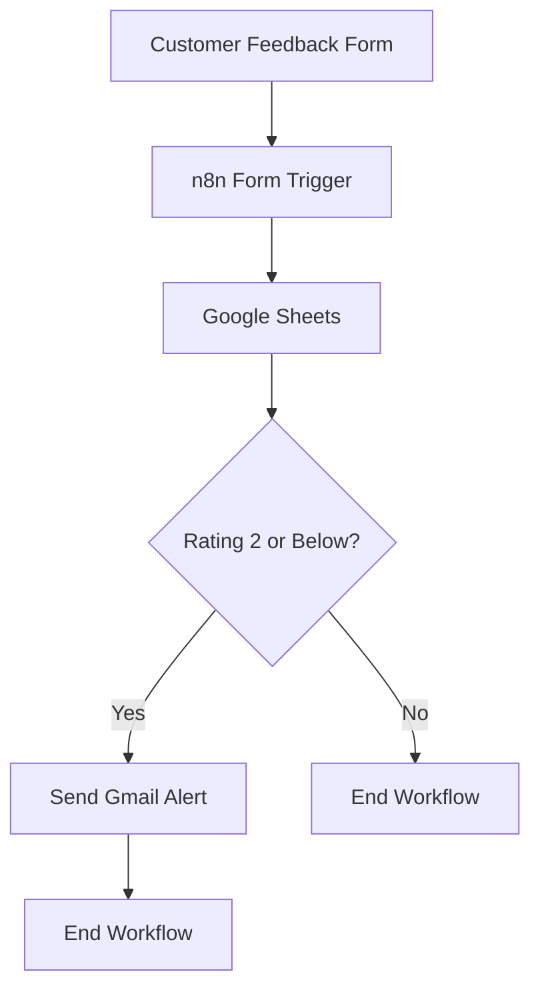

# Customer Feedback Automation | n8n

An automated customer feedback management workflow built with **n8n**, **Google Sheets**, and **Gmail**. The system collects customer feedback, stores responses, and automatically notifies the responsible team when a customer submits a low rating.

---

## Overview

Managing customer feedback manually can be time-consuming. This project automates the process of collecting, recording, and identifying negative customer experiences.

The workflow uses conditional logic to detect low ratings and trigger email notifications automatically.

## Workflow Architecture

## Key Features

- **Automated Feedback Collection:** Collects customer responses through an n8n form.
- **Google Sheets Integration:** Stores submitted feedback in a spreadsheet.
- **Conditional Rating Evaluation:** Checks whether a customer's rating is 2 or below.
- **Automatic Email Alerts:** Sends Gmail notifications when low ratings are detected.
- **Automated Execution:** Processes feedback without requiring manual intervention.

## Workflow Execution

| Customer Rating | Workflow Action                                    |
| --------------- | -------------------------------------------------- |
| 1–2             | Stores feedback and sends an email alert           |
| Above 2         | Stores feedback without sending a low-rating alert |

## Technologies Used

| Technology        | Purpose             |
| ----------------- | ------------------- |
| n8n               | Workflow automation |
| Google Sheets     | Feedback storage    |
| Gmail             | Email notifications |
| Conditional Logic | Rating evaluation   |

## Testing

The workflow was tested using different feedback ratings to verify its conditional behavior.

- **Low-rating test:** Confirmed that an email alert is triggered for ratings of 2 or below.
- **High-rating test:** Confirmed that feedback is stored without triggering a low-rating alert.

## Repository Contents

- Exported n8n workflow JSON file.
- Supporting workflow screenshots.
- Project documentation.

## Learning Outcomes

Through this project, I gained practical experience with:

- Building automated workflows in n8n.
- Working with form triggers.
- Integrating Google Sheets and Gmail.
- Implementing conditional logic.
- Testing automation workflows.

---

## Author

**Noorwali Khan**
BS in Computer Science | FUUAST Islamabad, Pakistan

[GitHub Profile](https://github.com/Noor72353)

---

_Part of my AI Automation Internship project portfolio._
