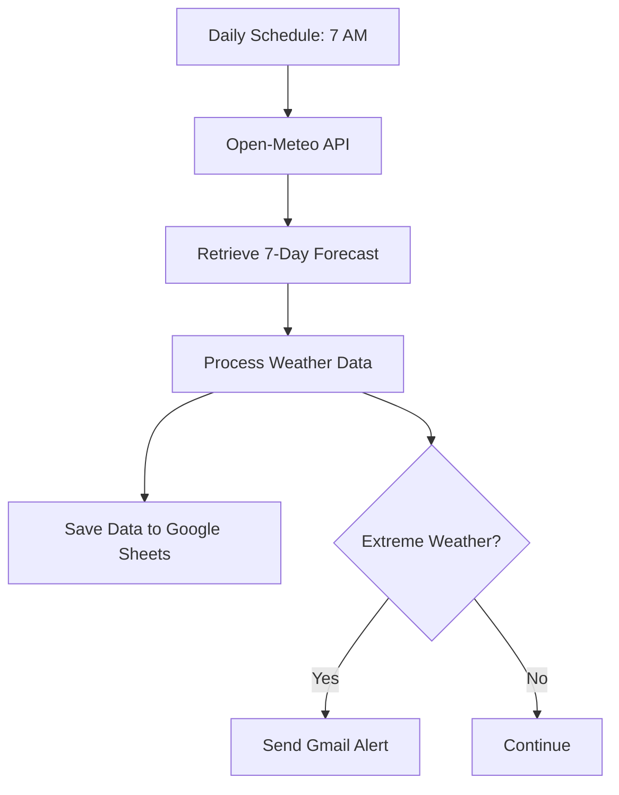
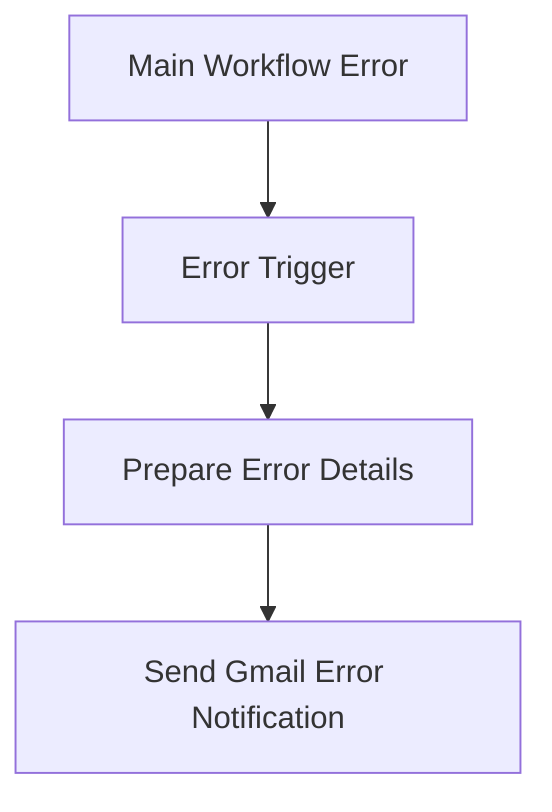

# Weather Monitoring & Reporting Automation | n8n

An automated weather monitoring and reporting system built with **n8n**, **Open-Meteo API**, **Google Sheets**, and **Gmail**. The workflow retrieves Islamabad's 7-day weather forecast, stores daily weather data, and sends email alerts when extreme weather conditions are detected.

---

## Overview

This project automates daily weather monitoring to reduce the need for manual weather checks.

The workflow runs every day at **7:00 AM (Pakistan Standard Time)**, retrieves a 7-day forecast for Islamabad, records the weather information in Google Sheets, and sends email notifications when configured extreme weather conditions are identified.

A separate error-handling workflow sends an email notification when the main workflow encounters a technical failure.

## Workflow Architecture

### Main Weather Monitoring Workflow

### Error Handling Workflow

## Key Features

- **Scheduled Execution:** Automatically runs daily at 7:00 AM Pakistan Standard Time.
- **Weather API Integration:** Retrieves forecast information using the Open-Meteo API.
- **7-Day Forecast:** Monitors upcoming weather conditions for Islamabad.
- **Google Sheets Integration:** Stores daily forecast data for record keeping.
- **Extreme Weather Detection:** Identifies configured extreme weather conditions.
- **Email Notifications:** Sends Gmail alerts when extreme conditions are detected.
- **Error Handling:** Uses a separate workflow to notify about technical failures.

## Technologies Used

| Technology        | Purpose                                |
| ----------------- | -------------------------------------- |
| n8n               | Workflow automation                    |
| Open-Meteo API    | Weather forecast data                  |
| Google Sheets     | Weather data storage                   |
| Gmail             | Weather alerts and error notifications |
| Schedule Trigger  | Daily workflow execution               |
| Conditional Logic | Extreme weather detection              |

## Workflow Execution

1. The schedule trigger starts the workflow every morning at 7:00 AM.
2. The workflow requests Islamabad's weather forecast from Open-Meteo.
3. Weather data is processed.
4. Forecast records are saved to Google Sheets.
5. The workflow checks for configured extreme weather conditions.
6. Gmail sends an alert when an extreme condition is detected.
7. A separate error workflow handles technical failures and sends an error notification.

## Testing

The project was tested to verify its main automation functions:

- Daily weather report generation.
- Weather forecast retrieval from Open-Meteo.
- Google Sheets data storage.
- Extreme weather alert email.
- Error notification email.

## Repository Contents

- `Daily Weather Report Automation.json` — Main workflow export.
- `Weather Report - Error Handler.json` — Error-handling workflow export.
- `Daily Weather Report.png` — Weather report screenshot.
- `Extreme Weather Alert - Islamabad.png` — Extreme weather alert screenshot.
- `ERROR Daily Weather Report Workflow Failed.png` — Error notification screenshot.

## Learning Outcomes

Through this project, I gained practical experience with:

- Integrating external REST APIs into n8n.
- Scheduling automated workflows.
- Processing weather forecast data.
- Connecting n8n with Google Sheets and Gmail.
- Implementing conditional alert logic.
- Building separate error-handling workflows.

---

## Author

**Noorwali Khan**
BS in Computer Science | FUUAST Islamabad, Pakistan

[GitHub Profile](https://github.com/Noor72353)

---

_Part of my AI Automation Internship project portfolio._
