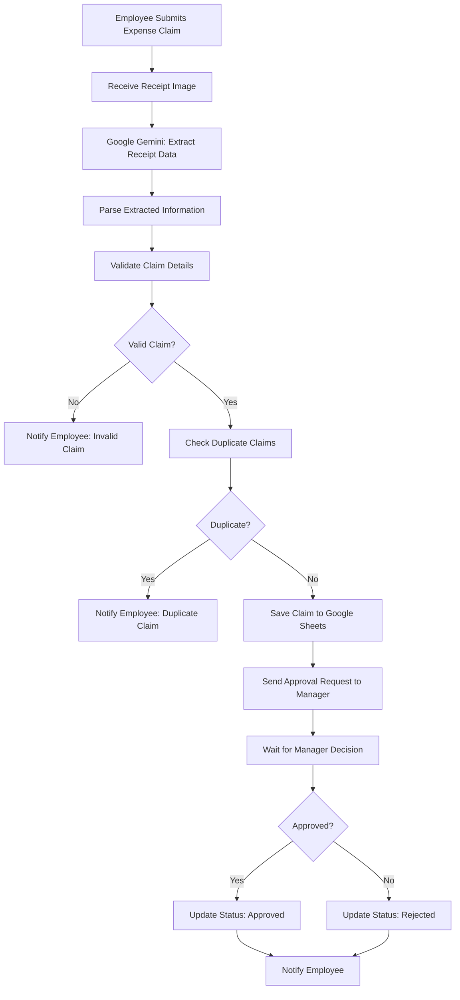
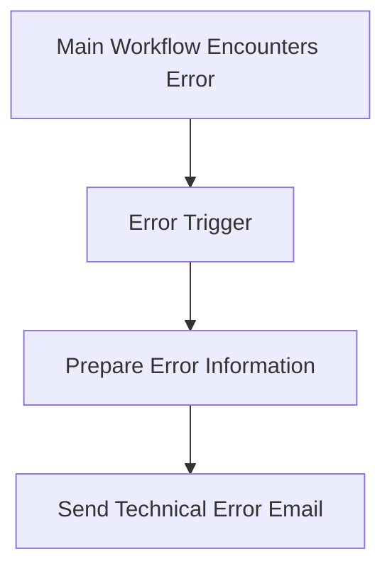

# Expense Claim Approval System | n8n

An AI-powered expense claim processing and approval automation system built using **n8n**, **Google Gemini**, **Google Sheets**, and **Gmail**. The system extracts information from receipt images, validates expense claims, detects duplicate submissions, and automates manager approval or rejection.

---

## Overview

Processing employee expense claims manually can be time-consuming and prone to errors.

This project automates the expense claim lifecycle, from receipt submission to manager review and employee notification.

It combines AI-based receipt information extraction with automated validation, duplicate detection, approval handling, and error notifications.

## Workflow Architecture

### Main Expense Claim Workflow

### Error Handling Workflow

## Key Features

- **Expense Claim Submission:** Employees submit expense claims through an online form with receipt images.
- **AI Receipt Extraction:** Google Gemini extracts relevant information, including merchant name, receipt date, receipt number, total amount, and tax amount.
- **Data Validation:** Checks submitted claim information and extracted receipt details.
- **Duplicate Detection:** Checks existing records to identify duplicate expense claims.
- **Google Sheets Integration:** Stores validated expense claim records and approval statuses.
- **Manager Approval:** Sends an approval request to the manager through Gmail.
- **Automated Decision Handling:** Processes manager approval or rejection through email response links.
- **Employee Notifications:** Sends employees confirmation emails about approval or rejection.
- **Error Handling:** A separate workflow detects technical failures and sends error notifications.

## Expense Claim Processing

| Stage           | System Action                                     |
| --------------- | ------------------------------------------------- |
| Submission      | Receives employee details and receipt image       |
| Extraction      | Uses Google Gemini to extract receipt information |
| Validation      | Checks claim information and receipt readability  |
| Duplicate Check | Checks existing expense records                   |
| Storage         | Saves valid claims in Google Sheets               |
| Approval        | Sends claim to the manager for review             |
| Decision        | Processes approval or rejection                   |
| Notification    | Emails the employee with the final decision       |

## Technologies Used

| Technology    | Purpose                                           |
| ------------- | ------------------------------------------------- |
| n8n           | Workflow automation and orchestration             |
| Google Gemini | AI-based receipt data extraction                  |
| Google Sheets | Expense record storage and status tracking        |
| Gmail         | Manager approval requests and email notifications |
| JavaScript    | Data processing and validation logic              |
| n8n Wait Node | Pauses execution until manager response           |
| Error Trigger | Handles technical workflow failures               |

## Testing Scenarios

The system was tested with different scenarios to verify its processing and decision-making logic.

| Test Scenario       | Expected System Behavior                                                      |
| ------------------- | ----------------------------------------------------------------------------- |
| Manager Approval    | Updates claim status to Approved and notifies employee                        |
| Manager Rejection   | Updates claim status to Rejected and notifies employee                        |
| Duplicate Claim     | Detects an existing claim and sends a duplicate notification                  |
| Missing Information | Identifies invalid or incomplete claim details                                |
| Unreadable Receipt  | Handles receipts that cannot be processed reliably                            |
| Technical Error     | Triggers the separate error-handling workflow and sends an email notification |

## Repository Contents

### Main Workflow

- `Task 3 - Expense Claim Approval System.json` — Main expense claim automation workflow.

### Error Handler

- `Task 3 - Expense Claim Error Handler.json` — Separate technical error-handling workflow.

### Screenshots

- `Main_Workflow_Overview.png`
- `Manager_Approval_Email.png`
- `Employee_Approval_Email.png`
- `Employee_Rejection_Email.png`
- `Duplicate_Claim_Email.png`
- `Invalid_Claim_Email.png`
- `Technical_Error_Email.png`
- `Error_Handler_Workflow.png`
- `Expense_Records.png`

### Documentation

- `Task 3 - Documentation.pdf`
- `Task 3.docx`

## Learning Outcomes

Through this project, I gained practical experience with:

- Building multi-step AI automation workflows using n8n.
- Integrating Google Gemini for document and receipt data extraction.
- Processing and validating structured information.
- Implementing duplicate detection using Google Sheets.
- Creating manager approval workflows with email-based decisions.
- Using Wait nodes for human-in-the-loop automation.
- Sending automated email notifications through Gmail.
- Designing separate error-handling workflows.
- Testing end-to-end automation under different scenarios.

---

## Author

**Noorwali Khan**
BS in Computer Science | FUUAST Islamabad, Pakistan

[GitHub Profile](https://github.com/Noor72353)

---

_Part of my AI Automation Internship project portfolio._
